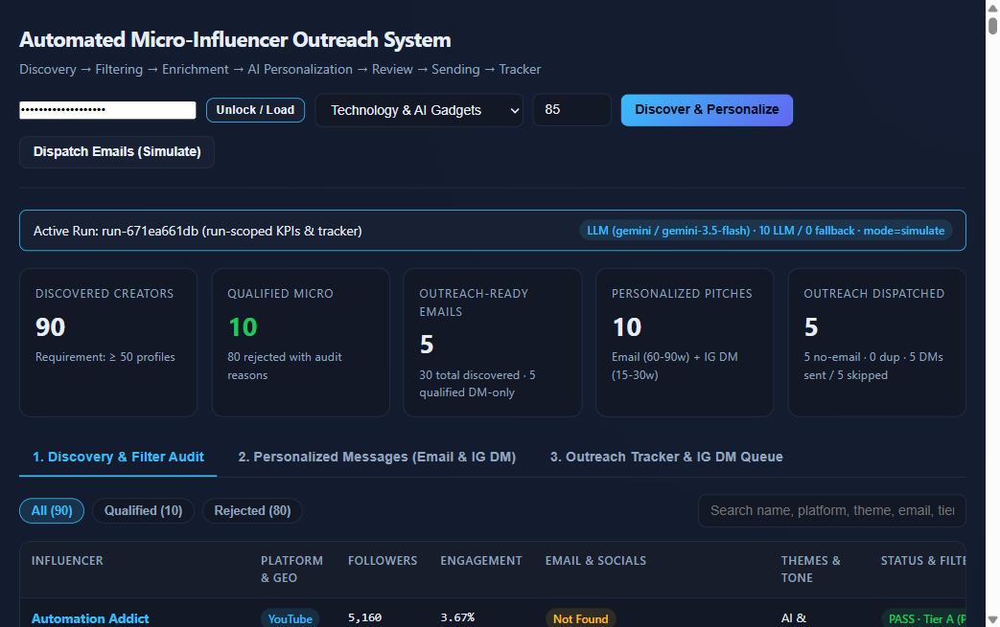
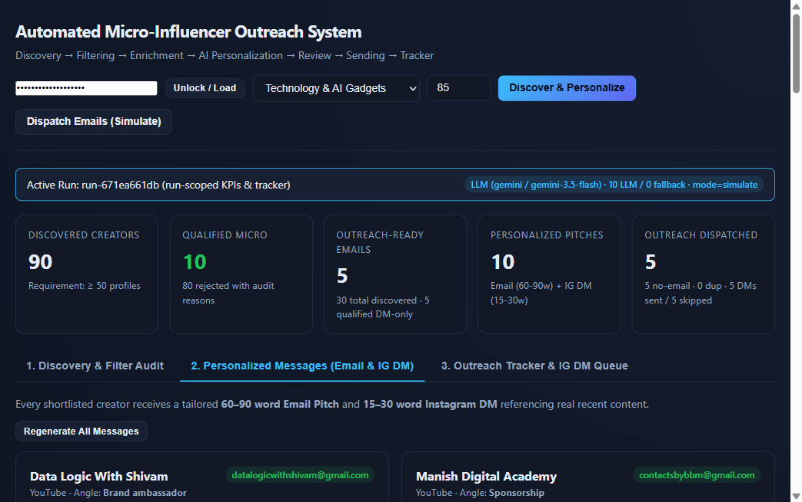
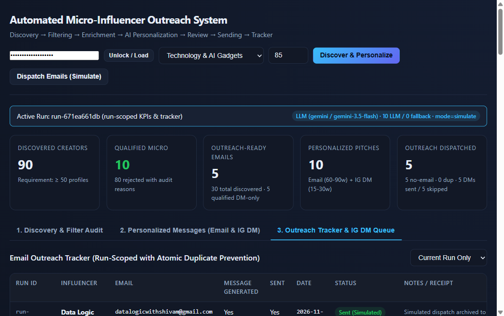

# Automated Micro-Influencer Outreach System (EDXSO AI Engineer Intern – Assignment 1)

An end-to-end automated pipeline, authenticated FastAPI review dashboard, and n8n automation workflow that discovers real micro-influencers (**50+ profiles** per run), evaluates them with transparent pass/fail filtering logic, enriches public contact and content context without fabricating unavailable data, generates personalized **Email Collaboration Pitches (60–90 words)** and **Instagram DMs (15–30 words)**, and simulates or dispatches outreach with atomic SQLite duplicate protection and run-scoped tracking.

```text
YouTube + Bluesky ──▶ Async Discovery (90 real creators)
                          │
                          ▼
               Multi-Criteria Filter & Tier Classifier (PASS / FAIL + strict recency & content-based niche)
                          │
                          ▼
               Profile Enrichment (Bio + Video Desc + Link-Hub OSINT + conservative cross-platform detection)
                          │
                          ▼
               Run-Scoped Personalization Engine (Gemini / OpenAI / Groq / Anthropic / Ollama + dynamic-nlg-v1)
                     ├──▶ Email Pitch (60–90 words)
                     └──▶ Instagram DM (15–30 words)
                          │
                          ▼
               Authenticated FastAPI Review Dashboard & Fixed n8n Workflow (Code-node array split)
                     ├──▶ Email Sender (Simulated Outbox w/ Receipt IDs | SMTP SSL/465 & STARTTLS/587 + Atomic Dedup)
                     └──▶ Compliant Instagram DM Queue (Manual / Simulated Send + Persisted Duplicate Audit Log)
```

---

## 1. Technology Stack

- **Language & Runtime:** Python 3.11+ (tested on Python 3.14.6)
- **Async HTTP & Parsing:** `httpx`, `beautifulsoup4`, `xml.etree.ElementTree`, `regex`
- **Data Validation & Config:** `pydantic` v2, `pydantic-settings`, `python-dotenv`
- **Storage & Exports:** SQLite (`WAL` mode + `BEGIN IMMEDIATE` atomic locks + partial unique indexes), UTF-8 BOM CSV (`utf-8-sig`), JSON, Markdown, RFC-2822 `.eml` outbox receipts
- **AI / LLM Layer:** Multi-provider async adapter (`google-genai`, `openai`, `groq`, `anthropic`, `ollama`) with JSON schema parsing, word-count refinement retry loop, and multi-angle `contextual_fallback` (`dynamic-nlg-v1`)
- **Web API & Review UI:** `fastapi`, `uvicorn`, token-authenticated read and mutating API endpoints (`X-API-Key` / Bearer, leaving `GET /` shell and `/api/health` public), vanilla HTML/CSS/JS review dashboard (`Unlock / Load` key prompt)
- **Automation Orchestration:** Exportable n8n workflow ([workflows/n8n_micro_influencer_outreach.json](workflows/n8n_micro_influencer_outreach.json)) + CLI (`outreach`)
- **Quality & Testing:** `pytest`, `pytest-asyncio`, `ruff`, Node.js (for validating the n8n Code-node JavaScript contract)

---

## 2. APIs & Tools Used

| Component | API / Tool | Auth Required | Purpose |
| :--- | :--- | :--- | :--- |
| YouTube Discovery | Public YouTube Search HTML (`ytInitialData`) & Channel `/about` | None | Discover creators by niche queries; extract subscriber counts, bios, country, and official external links |
| YouTube Metrics & Feed | Official Public YouTube Atom RSS (`feeds/videos.xml?channel_id=...`) | None | Fetch up to 12 latest videos, publish timestamps, view counts, `media:starRating` like counts, and video descriptions |
| Bluesky Discovery | Public Bluesky AppView REST API (`public.api.bsky.app/xrpc/...`) | None | Discover creators (`searchActors`), fetch profiles (`getProfile`), and fetch engagement metrics (`getAuthorFeed`) |
| External OSINT Crawl | `httpx` + `BeautifulSoup` | None | Crawl creator-owned Linktree / Beacons / personal websites for `mailto:` or public business emails and social handles |
| AI Personalization | Gemini / OpenAI / Groq / Anthropic / Ollama APIs | API key in `.env` (or local Ollama) | Generate JSON-structured Email pitches and Instagram DMs; transparently uses `contextual_fallback` (`dynamic-nlg-v1`) when unconfigured |
| Email Delivery | Local Outbox (`.eml` + `.receipt.json`) or `smtplib` (`SMTP_SSL` 465 / `STARTTLS` 587) | Optional SMTP + `ALLOW_LIVE_SMTP=true` | Safely simulate email outreach by default or dispatch via live SMTP when explicitly authorized |
| API Auth & Workflow | FastAPI (`X-API-Key` / Bearer) + n8n JSON DAG | `OUTREACH_API_KEY` | Authenticate sensitive read and mutating endpoints and orchestrate per-creator routing in n8n |

---

## 3. Data Sources & Integrity Policy

All creator metrics, recent titles, geographies, social handles, and business emails are **real, publicly observable records** collected at runtime—no fabricated profiles, guessed emails, or synthetic engagement numbers:

1. **YouTube** (`youtube.com/results`, `/channel/<id>/about`, `feeds/videos.xml`)
2. **Bluesky** (`public.api.bsky.app`)
3. **Creator External Links** (`channel_bio`, `video_description`, creator Link-hubs/websites; affiliate shorteners like `geni.us`, `amzn.to`, `bit.ly` are excluded from website email crawling).

Unavailable private analytics (**Audience Age**, **Audience Gender**) and unshared contact emails are explicitly marked `"Not Available (Private Analytics)"` and `"Not Found"`.

---

## 4. Discovery & Conservative Cross-Platform Identity

1. **Topic-Anchored Querying:** `YouTubeDiscoverer` runs 14 niche queries (alternating unfiltered and "This month" `sp=EgIIBA%3D%3D` filters) and `BlueskyDiscoverer` queries Bluesky AppView concurrently via `asyncio.gather`, deduplicating exact profile URLs.
2. **Real Engagement Computation & Hidden-Metric Detection:**
   - **YouTube:** `engagement_rate = (avg_likes / followers) * 100` across up to 12 latest RSS videos, alongside `avg_views`, `engagement_by_views_pct`, and `view_to_subscriber_pct`. When RSS returns `0` likes across videos, `YouTubeDiscoverer._are_video_likes_hidden()` inspects the watch-page `factoidRenderer`: hidden like counts (`"N/A"`) are stored as `None` (`"Unavailable"` in UI/CSV, `Engagement data unavailable`) rather than falsely reporting `0.00%`, whereas visible `"0"` likes remain `0.00%` with explicit low-engagement/low-view rejection criteria.
   - **Bluesky:** `engagement_rate = avg(likes + reposts + replies + quotes) / followers * 100` across non-repost author feed items.
3. **Conservative Cross-Platform Identity Detection:** [`annotate_cross_platform_identities`](src/outreach_system/enrichment/enricher.py) links profiles across platforms into a shared `identity_cluster_id` **only** when a verified public email or explicit cross-profile URL link matches. Profiles with similar display names alone are **never merged**, remain separate platform-specific records, and are documented as uncertain display-name similarities.

---

## 5. Filtering, Classification & Email Readiness Separation

Implemented in [src/outreach_system/filtering/classifier.py](src/outreach_system/filtering/classifier.py). Every discovered creator receives a transparent `FilterDecision` (`Qualified` or `Rejected`), composite `filter_score` (0–100), `tier`, `passed_criteria`, `failed_criteria`, and `filter_summary`:

1. **Follower Band & High-Engagement Equivalence:**
   - Standard pass: `5,000 <= followers <= 100,000`.
   - High-engagement nano exception: `2,000 <= followers < 5,000` when `engagement_rate >= 2.0%` and `avg_views >= 1,500`.
   - Rejects `> 100,000` (`Macro / Mega`) and `< 5,000` without equivalent engagement (`Nano / Low Reach`).
2. **Engagement Rate (Hardened):**
   - Primary pass: `engagement_rate >= 0.40%` **and** (on YouTube) `avg_views >= 500`.
   - Documented high-reach YouTube exception: `engagement_rate >= 0.30%` **and** `avg_views >= 5,000` **and** (`view_to_subscriber_pct >= 35.0%` or `engagement_by_views_pct >= 2.0%`).
3. **Niche Relevance (Content-Only):** Computed strictly from creator-owned content (`bio`, recent video/post titles, snippets, and video descriptions)—**never** from the channel's display name alone or discovery query string—requiring `>= 0.33` relevance (`>= 2` distinct niche keywords).
4. **Activity Recency (Strict Policy):** Requires a verified post within the last `120` days. Profiles with `last_post_date = None` (`Unknown/Unverified`) are rejected (`Rejected (Unverified Activity)`) when `REQUIRE_VERIFIED_RECENCY=true`. Creators failing only inactivity (including high-engagement nano profiles) are labeled `Rejected (Inactive)`.
5. **Brand Safety:** Word-boundary regex checks across name, bio, titles, and descriptions against restricted terms (`online casino`, `gambling`, `sports betting`, `onlyfans`, `porn`, etc.).
6. **Qualified vs. Outreach-Ready Separation:** Creators passing quality filters remain `Qualified` even when no public email is posted, and are explicitly separated via `outreach_ready` (`"Outreach-Ready (Email Verified)"` vs. `"Qualified (Not Email-Ready - DM Only)"`).

### Verified Latest Run Results (`run-671ea661db`, Technology & AI Gadgets)

- **Discovered:** **90** real creators (`70` YouTube, `20` Bluesky)
- **Qualified Micro-Influencers:** **10** (`7` Tier A Priority Micro, `3` Tier B Standard Micro)
  - **Outreach-Ready (Verified Email):** **5**
  - **Qualified DM-Only (Email Not Found):** **5**
- **Rejected with Explicit Audit Reasons:** **80** (`43` Macro/Mega, `19` Nano/Low Reach, `10` Off-Niche, `6` Low Engagement, `1` Engagement Unavailable, `1` Inactive — 3 YouTube profiles with hidden public video likes report `Engagement = Unavailable` rather than false `0.00%`, while 3 profiles with visible `0` likes report `Actual engagement rate 0.00% below minimum` + `YouTube average views ... below minimum`)
- **Total Public Emails Found (All 90):** **30**
- **Run-Scoped Personalized Messages:** **10** (`68–86` words Email, `23–28` words Instagram DM; **`10/10` generated via live Google Gemini `gemini-3.5-flash` with `Generation Mode = LLM`**; `0` bound violations)
- **Outreach Dispatched (Simulated Only):** **5** `Sent (Simulated)` (outbox `.eml`/receipt archives; zero live SMTP emails sent), **5** `Skipped - No Email`, **5** Instagram DMs `Simulated Sent`, **5** `Skipped - No Instagram Handle` (`draft copy retained`)

---

## 6. Profile Enrichment Process

Implemented in [src/outreach_system/enrichment/enricher.py](src/outreach_system/enrichment/enricher.py):

1. **Public Email OSINT:** Scans channel bios (including `[at]`/`[dot]` obfuscations), recent video descriptions, and creator-owned Link-hubs/websites with SSRF guards. Supports RFC-valid single-character local parts (e.g., `a@domain.io`) while filtering placeholders, `noreply`, platform support, and asset filenames. Unavailable emails remain strictly `"Not Found"`.
2. **Cross-Platform Handles & Websites:** Prefers personal domains over link-hub aggregators (`linktr.ee`, `beacons.ai`) when setting `website`, and extracts Instagram, YouTube, and TikTok URLs.
3. **Content Themes, Tone & Demographics:** Classifies 1–3 content themes, infers `content_tone_style`, records public `audience_geography`, and leaves private `audience_age` / `audience_gender` as `"Not Available (Private Analytics)"`.

---

## 7. AI Model, Personalization & Run-Scoped Isolation

Implemented in [src/outreach_system/personalization/](src/outreach_system/personalization/) and [src/outreach_system/storage/database.py](src/outreach_system/storage/database.py):

- **AI Model & Prompt Engineering ([llm_client.py](src/outreach_system/personalization/llm_client.py), [prompts.py](src/outreach_system/personalization/prompts.py)):** Uses **Google Gemini (`gemini-3.5-flash` via `google-genai`)** as the primary configured LLM (`LLM_PROVIDER=auto`, with adapters for OpenAI, Groq, Anthropic, and Ollama). The structured system prompt (`build_personalization_prompts`) enforces strict JSON schema output (`email_subject`, `email_pitch`, `instagram_dm`, `personalization_signals_used`), `60–90` word email bounds, `15–30` word Instagram DM bounds, mandatory reference to verified creator niche/tone/recent title/audience/collaboration angle/brand value proposition, and a hard prohibition against fabricating unavailable facts or metrics. An automatic length-refinement retry + sentence-boundary enforcement guardrail verifies every message.
- **Provider & Generation Mode Disclosure:** When `GEMINI_API_KEY`, `OPENAI_API_KEY`, `GROQ_API_KEY`, `ANTHROPIC_API_KEY`, or local `Ollama` is configured and reachable, [`LLMClient`](src/outreach_system/personalization/llm_client.py) generates live LLM prose (`generation_mode = "LLM"`). In the included deliverables (`outputs/personalized_messages.*`), all **10/10** qualified creator messages were generated by **Google Gemini (`gemini-3.5-flash`)** and verified with `generation_mode = "LLM"`. Whenever an external provider is unavailable or unconfigured (or during offline/isolated runs), [`MessagePersonalizer`](src/outreach_system/personalization/generator.py) falls back deterministically to **`contextual_fallback` (`dynamic-nlg-v1`)** and records **`generation_mode = "contextual_fallback"`** individually per message—never mislabeling fallback copy as live LLM output. Dashboard `/api/summary` and header indicators display both the active provider/model and the live database `LLM` vs `contextual_fallback` counts alongside `mode=simulate`.
- **Dynamic NLG Fallback Quality & Limitations:** `dynamic-nlg-v1` selects collaboration angles (`Sponsorship`, `Paid product placement`, `UGC content creation`, `Affiliate campaign`, `Brand ambassador program`, `Barter collaboration`), varies openers, body copy, and CTAs deterministically across creator IDs, themes, tones, verified geographies, and normalized recent video titles (stripping hashtags/trailing stopwords), and crafts varied, natural email subjects. Limitation: compared to a live frontier LLM, fallback prose follows structured phrase banks rather than open-ended semantic synthesis.
- **Run-Scoped Message Isolation:** Every pipeline run generates a unique `run_id`. `personalized_messages` uses `(run_id, influencer_id)` as its primary key and marks previous runs `is_current = 0`. Historical messages remain auditable (`GET /api/messages/history`), while `GET /api/messages`, `/api/summary`, `dm_queue`, and CSV/JSON exports include **only** messages belonging to the current run's qualified creators—preventing stale-message inflation across repeated runs.

---

## 8. Sending Layer, Security & Atomic Duplicate Safety

- **Atomic Email Deduplication, Crash Recovery & Simulated vs. Live Boundary ([email_sender.py](src/outreach_system/sending/email_sender.py), [database.py](src/outreach_system/storage/database.py)):**
  - Uses SQLite `BEGIN IMMEDIATE` transactions paired with partial unique indexes on `outreach_log(influencer_id)` and `outreach_log(email_normalized)` (`WHERE status IN ('Sending', 'Sent (Simulated)', 'Sent (SMTP)', 'Verify Delivery - Uncertain SMTP')`) to eliminate check-then-insert concurrency races. Initial `Sending` claims record `sent = 0` until finalized.
  - **Simulated Email vs. Live Email:** Default simulation archives RFC-2822 `.eml` + `.receipt.json` files keyed as `{influencer_id}_{receipt_id}.eml` (with `Reply-To` and `List-Unsubscribe`, never overwriting prior receipts) and records **`Sent (Simulated)`**—**never** sending real external emails. Live SMTP (`Sent (SMTP)`, supporting `SMTP_SSL` port `465` and `STARTTLS` port `587`) is strictly blocked unless **both** `mode="smtp"` and `ALLOW_LIVE_SMTP=true` are explicitly configured; unsupported modes (such as `"live"`) fail with HTTP `422` / `ValueError`.
  - **Failure Finalization, Uncertain-SMTP Protection & Crash Recovery:** Pre-send SMTP rejections (`SMTPAuthenticationError`, `SMTPConnectError`, `SMTPRecipientsRefused`) and simulated MIME/outbox write errors finalize as `Failed` (`sent=False`, `receipt_id=""`). Conversely, uncertain mid-transmission SMTP exceptions (`SMTPServerDisconnected`, socket timeouts) or stale crashed `'Sending'` rows (`send_mode='smtp'`, `age > STALE_SENDING_TIMEOUT_SECONDS`) transition to **`Verify Delivery - Uncertain SMTP`** preserving `receipt_id` and locking automatic retries (`Skipped - Verification Pending`) until an operator explicitly confirms delivery or non-delivery via `POST /api/outreach/{log_id}/verify-smtp` or the dashboard **`Confirm Sent`** / **`Confirm Failed`** actions.
- **Run-Scoped Reporting & Historical Preservation ([database.py](src/outreach_system/storage/database.py), [pipeline.py](src/outreach_system/pipeline.py), [app.py](src/outreach_system/api/app.py)):**
  - `create_app()` reuses one shared `OutreachDatabase` handle (with thread-safe `_initialized_signatures` schema caching) so API read endpoints avoid per-request DDL overhead. `/api/summary`, `/api/outreach-log`, and `outreach_tracker.csv`/`.json` (with `Run ID` / `run_id`) are scoped to `current_run_id` so Sent/Skipped KPIs reflect the active run accurately across consecutive executions (`?current_only=false` and [outputs/outreach_history.json](outputs/outreach_history.json) preserve complete historical outreach records).
  - Re-syncing the Instagram DM queue preserves original dispatch `run_id` and historical `sent` status across subsequent runs.
- **Compliant Instagram DM Queue ([dm_workflow.py](src/outreach_system/sending/dm_workflow.py)):**
  - Never bypasses Instagram platform controls. Only creators with a verified public Instagram URL/handle are eligible for `Simulated Sent` / `Marked Sent Manually`; creators missing an Instagram handle (`"Not Found"`) remain `sent = 0` with status **`Skipped - No Instagram Handle`** in `dm_queue`, `dm_dispatch_log`, and `instagram_dm_queue.csv` (while retaining their generated `15–30` word draft DM text for manual review). Persists duplicate-block events (`last_event_status = "Skipped - Duplicate"`, `duplicate_attempts`, and `dm_dispatch_log`).
- **API Authentication, Validation & 500+ Batched Scaling ([app.py](src/outreach_system/api/app.py), [pipeline.py](src/outreach_system/pipeline.py)):**
  - Both sensitive read endpoints (`/api/summary`, `/api/influencers`, `/api/messages`, `/api/messages/history`, `/api/outreach-log`, `/api/dm-queue`) and mutating endpoints (`POST /api/pipeline/run`, `POST /api/pipeline/run-batch`, `/api/personalize/regenerate`, `/api/outreach/send`, `/api/outreach/send-bulk`, `/api/outreach/{log_id}/verify-smtp`, `/api/dm/{id}/simulate`, `/api/dm/{id}/mark-sent`) require `X-API-Key` or `Authorization: Bearer` matching `OUTREACH_API_KEY` (fail-closed `503` if unset, `401` if invalid). `GET /` and `GET /api/health` remain public; no API key is embedded in frontend HTML/JS, and the server binds to `127.0.0.1` by default.
  - **500+ Profile Support via Bounded Batches:** Single-call `POST /api/pipeline/run` remains bounded (`1..200`), while **`outreach run-batched --total 500 --batch-size 100`** (`POST /api/pipeline/run-batch`, `total_target` `1..1000`, `batch_size` `1..200`) processes large discovery runs incrementally under a single `run_id` with cross-batch URL deduplication, chunked enrichment/personalization, atomic cross-batch email deduplication, and `PRAGMA wal_checkpoint(TRUNCATE)` support. Note: live external YouTube/Bluesky calls still depend on upstream rate limits and sequential per-recipient SMTP handshakes when live SMTP is enabled.
  - `POST /api/outreach/send` returns **HTTP 400** for `influencer_ids: []` or IDs outside the current qualified shortlist, **HTTP 404** for unknown `influencer_id`s missing from SQLite, and requires explicit `POST /api/outreach/send-bulk` with `{"confirm_bulk": true, "mode": "simulate" | "smtp"}` for bulk dispatch.

---

## 9. n8n Workflow Fix & Verification Scope

The exported workflow ([workflows/n8n_micro_influencer_outreach.json](workflows/n8n_micro_influencer_outreach.json)) adds a **`Split & Validate Message Items`** Code node (`n8n-nodes-base.code` v2) directly after `Fetch Shortlisted Personalized Messages` (`GET /api/messages`):

- Unpacks the JSON array response into independent creator items (returning `[]` safely when empty).
- Filters out missing/null `influencer_id` values and invalid records.
- Evaluates `has_valid_email` and guards `"Not Found"` before branching in `Has Verified Public Email?`.
- Sends authenticated `X-API-Key: {{ $env.OUTREACH_API_KEY }}` headers on **all** API requests (both `GET /api/messages` and `GET /api/summary` reads as well as `POST` mutating nodes) and hard-pins `mode: 'simulate'` on email dispatch (`POST /api/outreach/send`) and `/api/dm/{{ encodeURIComponent($json.influencer_id) }}/simulate` for DM routing.
- **Manual Import & Activation Required:** The workflow JSON ships with `"active": false`. Before running in n8n, manually import [workflows/n8n_micro_influencer_outreach.json](workflows/n8n_micro_influencer_outreach.json) into n8n, set `OUTREACH_API_KEY` in n8n's environment variables (replacing `localhost` with `host.docker.internal` if n8n runs in Docker), and manually activate the workflow.

> **Verification Scope Note:** Neither `n8n` nor `docker` is installed in this local Windows environment, so a live n8n server daemon execution was not performed. Instead, [tests/test_n8n_workflow.py](tests/test_n8n_workflow.py) validates the workflow JSON schema/connections and executes the **exact JavaScript Code node logic** inside Node.js against live FastAPI `TestClient` `/api/messages` responses (including empty arrays, malformed missing-ID objects, email-ready creators, and DM-only creators) and verifies `HTTP 200` downstream calls to `/api/outreach/send` and `/api/dm/{id}/simulate`.

---

## 10. Working Demo Video & Dashboard Screenshots

- **Full Walkthrough Video (2m32s):** [docs/demo_video.mp4](docs/demo_video.mp4)

### Discovery, Filtering Audit & Outreach-Ready Separation


### Run-Scoped Personalized Messages (Email 60–90w & Instagram DM 15–30w)


### Outreach Tracker & Compliant Instagram DM Queue


---

## 11. Setup, Execution & Verification

### 1. Install Dependencies
```bash
python -m venv .venv
.\.venv\Scripts\Activate.ps1   # Windows PowerShell
pip install -e ".[dev]"
```

### 2. Configure Environment (`.env`)
```bash
cp .env.example .env
```
Set `OUTREACH_API_KEY` in `.env` before starting the web server for authenticated dashboard reads, mutating API actions, and n8n workflow requests. Optionally set `GEMINI_API_KEY`, `OPENAI_API_KEY`, `GROQ_API_KEY`, or `ANTHROPIC_API_KEY` (or run local Ollama) for live LLM generation.

### 3. Run Pipeline & Dashboard
```bash
# Run full pipeline (discovery -> filter -> enrich -> personalize -> simulate send -> export)
outreach run-all --niche technology --count 90 --send-mode simulate --simulate-dms --force-regen

# Or run large-scale (500+) batched pipeline safely under one run_id
outreach run-batched --niche technology --total 500 --batch-size 100 --send-mode simulate --simulate-dms

# Start FastAPI review dashboard (enter OUTREACH_API_KEY in the header input and click Unlock / Load)
outreach serve --host 127.0.0.1 --port 8000
```

### 4. Run Linter & Full Automated Test Suite
```bash
python -m ruff check .
python -m pytest -v
```
Verified release state: `ruff check .` passes cleanly (`0` errors) and **46/46 tests pass** across hidden YouTube like detection (`Unavailable` vs genuine `0.00%` + low views), explicit `generation_mode` (`LLM` vs `contextual_fallback`), uncertain SMTP delivery locking (`Verify Delivery - Uncertain SMTP` + `POST /api/outreach/{log_id}/verify-smtp` + stale SMTP crash handling), batched `520`-profile processing across bounded chunks with cross-batch dedup, Instagram DM missing-handle accuracy (`Skipped - No Instagram Handle`), historical DM log reconciliation, legacy database migration, simulated outbox / MIME failure `FAILED` finalization, multi-run sent/skipped KPIs, read/write endpoint authentication (`401`/`503` fail-closed), `404`/`400` unknown `influencer_id` validation, inactive-only tier classification, filtering loopholes, recency enforcement, conservative cross-platform identity detection, enrichment/single-char emails, personalization diversity/bounds, atomic concurrent duplicate protection, SMTP SSL/STARTTLS paths, duplicate DM status persistence, and the full n8n Code-node + API contract checklist.

### 5. Deliverables (`outputs/` & `workflows/`)
- [outputs/influencers_dataset.csv](outputs/influencers_dataset.csv) & [outputs/influencers_dataset.json](outputs/influencers_dataset.json)
- [outputs/shortlisted_enriched.json](outputs/shortlisted_enriched.json)
- [outputs/personalized_messages.csv](outputs/personalized_messages.csv) & [outputs/personalized_messages.json](outputs/personalized_messages.json)
- [outputs/outreach_tracker.csv](outputs/outreach_tracker.csv), [outputs/outreach_tracker.json](outputs/outreach_tracker.json), & [outputs/outreach_history.json](outputs/outreach_history.json)
- [outputs/instagram_dm_queue.csv](outputs/instagram_dm_queue.csv)
- [outputs/outbox/](outputs/outbox/)
- [workflows/n8n_micro_influencer_outreach.json](workflows/n8n_micro_influencer_outreach.json)
- [docs/demo_video.mp4](docs/demo_video.mp4) & [docs/screenshots/](docs/screenshots/)
